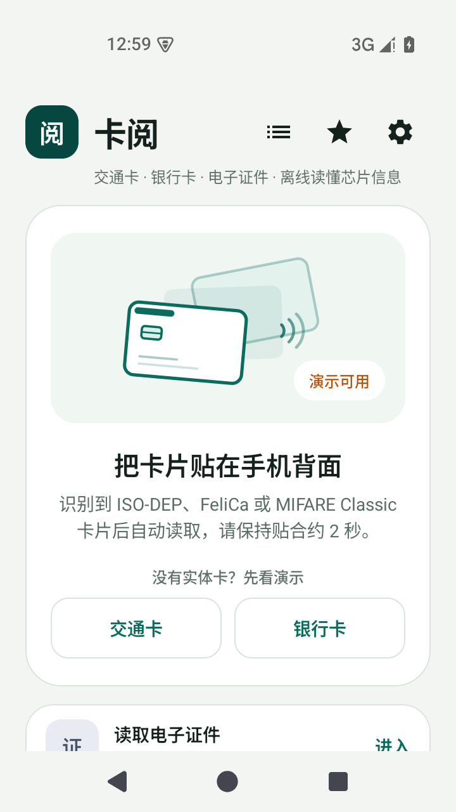
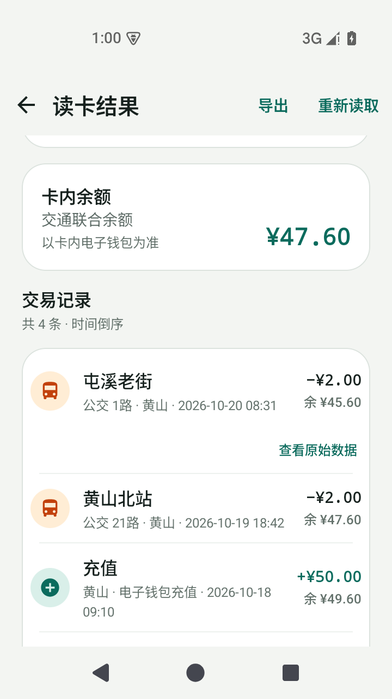
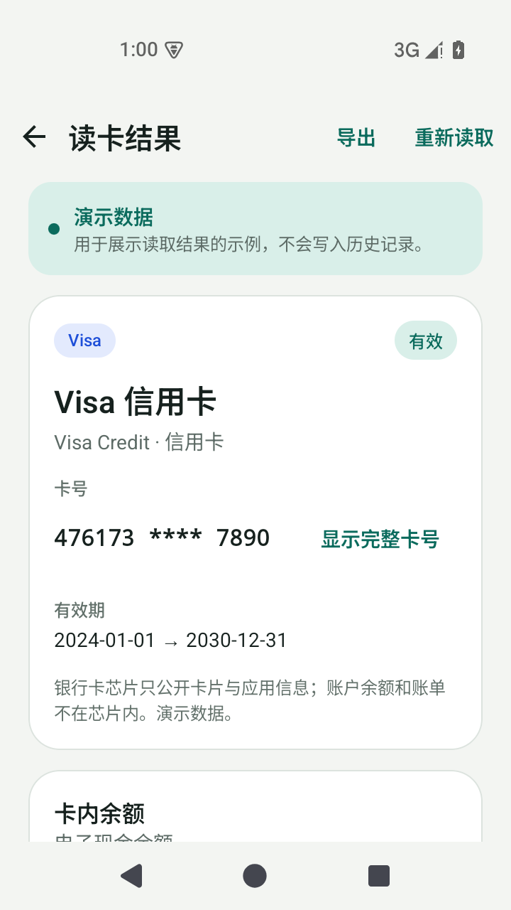
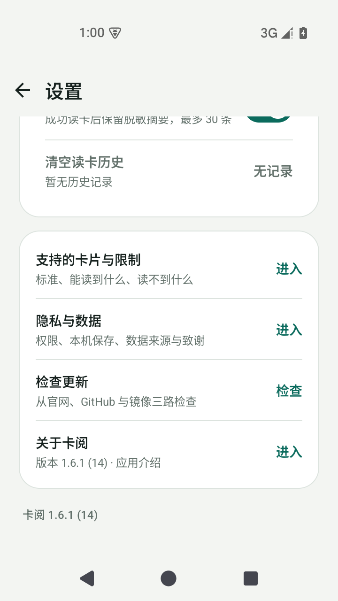

# 卡阅 SuperReader

只读的 NFC 卡片信息工具。Android 版读取交通卡、PBOC / EMV 银行卡与 ICAO 电子证件；Windows 版通过 PC/SC 读卡器读取银行卡公开数据。读卡与解析都在本机完成，只有用户手动点击“检查更新”时，才通过 HTTPS 读取官网、GitHub 或镜像站的版本清单。

- 官网：[superreader.828696.xyz](https://superreader.828696.xyz/)
- GitHub Pages 原始地址：[zsof-rui.github.io/SuperReader](https://zsof-rui.github.io/SuperReader/)（仓库已设置自定义域名，会跳转到官网域名）
- 问题反馈：[Issues](https://github.com/ZSOF-Rui/SuperReader/issues)
- 版本历史：[CHANGELOG.md](CHANGELOG.md)

> 当前安装包均为**测试签名**，未上架应用商店，也不是银行或交通运营商的官方工具。六张实验卡、回乡证与台胞证实验入口、Windows 桌面版、卡产品名与全球 BIN 推断都还没有完成真实卡片验收。

## 下载

| 渠道 | 版本 | 包名 | 下载 |
| --- | --- | --- | --- |
| Android 正式版 | 1.9.0 (19) | `com.superreader.app` | [SuperReader-1.9.0.apk](site/downloads/SuperReader-1.9.0.apk) |
| Android 预览版 | 1.9.0-preview6 (39) | `com.superreader.app.preview` | [SuperReader-1.9.0-preview6.apk](site/downloads/SuperReader-1.9.0-preview6.apk) |
| Windows 测试版 | 1.1.0-preview2 | 免安装 zip | [SuperReader-Windows-1.1.0-preview2-r2.zip](site/downloads/SuperReader-Windows-1.1.0-preview2-r2.zip) |

安装前请核对 SHA-256；方法见 [docs/VERIFY-RELEASES.md](docs/VERIFY-RELEASES.md)。正式版与预览版包名不同，可以同时安装；开发版 1.9.0-dev13 (41) 不对外发布。

### Android 版本差异

| 版本 | 内容 |
| --- | --- |
| 正式版 1.9.0 | 交通联合、城市一卡通、PBOC / EMV 银行卡、电子护照与港澳台通行证；六张实验卡；全球公开卡种目录与公开密钥库、ICOCA / PASMO 与 NETS FlashPay 识别、MIFARE MAD 修正与 SAK 0x28 卡的 MIFARE 兼容区只读回退；四套配色（8 组明暗）、回乡证 / 台胞证实验入口、163 家银行产品名与等级、全球 6 位 BIN 离线兜底；交通卡线路与站点按乘车城市匹配，并支持常州地铁终端取位；换乘 / 免费换乘 / 异地用卡 / 清晨 / 夜间推断标记覆盖所有交通卡记录，异地用卡也覆盖出租与小额消费；本版起提供本机 MIFARE Classic 密钥导入（最多 32 把，只存本机、掩码显示、不做字典爆破）；启动后自动检查更新；保存后可自定义卡名称 |
| 预览版 1.9.0-preview6 | 在正式版基础上保留手机读卡桥接（只监听本机局域网、只传脱敏诊断文本）与开发设置项；独立包名，可与正式版共存 |
| 开发版 1.9.0-dev13 | 与预览版同源，用于内部核验；暂未发布 |

## 界面预览

<p align="center">
  
  
  
  
</p>

截图来自 Android 模拟器，卡片、余额与交易均为**演示数据**，不是真实卡片的读取结果；六张实验卡、BIN 推断与 Windows 桌面版仍需真卡验收。1.6.1 发布时制作的[宣传海报](docs/images/release-1.6.1-poster.png)仍保留在仓库中，仅作历史资料。

## 能做什么

- **交通卡**：交通联合、城市一卡通余额与交易记录，线路与站点按卡内乘车城市而不是发卡城市查站点表；站点表只覆盖有公开数据的城市，查不到时显示卡内编码与终端号，不猜线路名。所有版本都会在交易记录上推断换乘 / 免费换乘 / 异地用卡 / 清晨 / 夜间标记，异地用卡也覆盖出租与小额消费；这些标记只作参考，不是城市优惠规则的确认结果。正式版与预览版另提供八达通、澳门通、悠游卡、T-money、Suica、EZ-Link 六张实验卡读取，开发版同样包含。
- **银行卡**：PBOC / EMV 公开数据，卡号默认脱敏；离线 BIN 表只用于参考发卡行、卡种与卡产品名。
- **电子证件**：电子护照与港澳台通行证公开字段、证件照；三个版本另提供回乡证（CR 机读码）与台胞证（CT 机读码）实验入口。读取公开数据，不做签证、真伪或签发机构认证。
- **本机保存**：历史、卡包、诊断导出都在应用私有目录；保存时可自定义卡名称，结果页标题优先显示自定义名，原卡片名作为副标题；可随时清空。四个版本都可以导入自己的 MIFARE Classic 密钥（最多 32 把），密钥只存本机、设置页掩码显示，不写进读卡报告与诊断导出。

## 不能做什么

- 不写卡、不克隆、不模拟、不圈存、不破解密钥：不做字典爆破，也不猜未提供的密钥；用户导入的密钥只用于读取自己的卡。
- 不上传卡号、BIN、证件信息或读卡结果；没有账号、统计、广告或崩溃上报。
- 更新检查只在启动后自动进行一次、或用户点击“检查更新”时访问下面三个 HTTPS 地址；只读取版本清单，同一版本不重复提示，也没有后台轮询。
- 不保证实验卡、BIN 推断或余额解析的准确性；以卡面、银行与交通运营商官方信息为准。

## 更新检查

应用启动后会静默检查一次，发现更高版本时弹窗提示；也可以在“设置 → 检查更新”手动复查。两条路径都并发查询三条来源，按版本号选择较新的正式版或预览版清单：

1. 官网：`https://superreader.828696.xyz/data/releases.json`
2. GitHub：`https://raw.githubusercontent.com/ZSOF-Rui/SuperReader/main/site/data/releases.json`
3. 镜像站：`https://superreader-update-ch09cuq83vg.qoder.website/data/releases.json`

三处使用同一份 `site/data/releases.json`，只读取版本号、下载地址、大小与 SHA-256，不上传任何设备或卡片数据。任一来源失败时其余来源仍可完成检查；版本号相同时按官网、镜像站、GitHub 的顺序取下载地址。应用只接受 `https`，会校验包名、APK 相对路径、版本号与哈希格式；下载仍在浏览器中完成。清单格式和失败回退规则见 [docs/UPDATE-CHECK.md](docs/UPDATE-CHECK.md)。

## 仓库内容

这个仓库只发布**站点、文档、参考资料索引和安装包**，不包含 Android / Windows / iOS 的核心源码。

```
site/                 官网、下载页、版本清单、Web NFC 实验页
docs/                 平台可行性、更新检查、安装包校验
references/           公开协议与开源项目索引（仅链接与说明）
scripts/               站点与镜像产物的链接、清单和安装包完整性检查
.github/workflows/    GitHub Pages 与站点检查
```

核心源码、签名密钥、真实卡片数据、第三方 APK、规范 PDF 与含第三方角色的宣传素材**不在本仓库**。完整边界见 [CONTRIBUTING.md](CONTRIBUTING.md)。

## 本地预览

需要 Node.js 20+ 与 Python 3：

```bash
python -m http.server 8765 --directory site
# 打开 http://127.0.0.1:8765/
node scripts/check-site.mjs
```

不要直接双击 `site/index.html`：页面用 `fetch()` 读取 `site/data/releases.json`，`file://` 下会被浏览器拦截。

`site/lab/web-nfc.html` 是只读 NDEF 演示，只在 Android Chrome 且 HTTPS / localhost 下可用；Web NFC 不能读取交通卡、银行卡或护照芯片。

## 发布流程

1. 更新 `site/downloads/` 中的安装包，文件名带版本号。
2. 更新 `site/data/releases.json` 对应渠道的 `versionCode`、大小、SHA-256 与说明；同一渠道的 `versionCode` 必须递增。
3. 同步更新 `site/index.html` 中展示的版本、大小与 SHA-256。
4. 运行 `node scripts/check-site.mjs`。
5. 提交并推送；GitHub Actions 检查通过后部署 `site/` 到 Pages。
6. 同步 `site/data/releases.json` 与最新两个 APK 到本地 `dist/qsite/`，重新发布镜像站（第三更新源，不超过 50 MiB）。

详细步骤见 [site/README.md](site/README.md)。

## 数据与许可

- 站点源码、文档、参考资料索引与脚本：MIT，见 [LICENSE](LICENSE)。
- `site/downloads/` 下的 APK / ZIP 与未公开的应用源码：专有，见 [APP-LICENSE.md](APP-LICENSE.md)。
- 第三方库、公开数据与协议来源：见 [THIRD_PARTY_NOTICES.md](THIRD_PARTY_NOTICES.md) 与 [docs/DATA-SOURCES.md](docs/DATA-SOURCES.md)。
- 城市、卡种与站点数据参考读卡识途公开的 `tripreader-data`（CC BY 4.0）；BIN 数据来自 `bankcard`、`card-bin-db`、`banks-db` 等公开整理。数据可能过期、缺行或误标，不构成权威结论。

## 安全与隐私

- 只读取你本人持有或已获授权的卡片。
- 不要在 Issue 中粘贴完整卡号、证件号、证件照、密钥、签名文件或原始 APDU。
- 安全问题请按 [SECURITY.md](SECURITY.md) 私下报告，不要先开公开 Issue。
- 本项目按“现状”提供，不提供任何担保；详见 [LICENSE](LICENSE) 与 [APP-LICENSE.md](APP-LICENSE.md)。

## 参与

欢迎提交站点、文档、数据来源更正与 Bug 报告。核心源码不接受外部代码贡献；请先阅读 [CONTRIBUTING.md](CONTRIBUTING.md) 与 [CODE_OF_CONDUCT.md](CODE_OF_CONDUCT.md)。

## 致谢

感谢 [读卡识途 Trip Reader](https://github.com/domosekai/tripreader-data)、[Metrodroid](https://github.com/metrodroid/metrodroid)、[bankcard](https://github.com/caijf/bankcard)、[card-bin-db](https://github.com/checkv4/card-bin-db)、[banks-db](https://github.com/ramoona/banks-db) 等公开项目与数据整理者。完整清单见 [references/README.md](references/README.md)。
